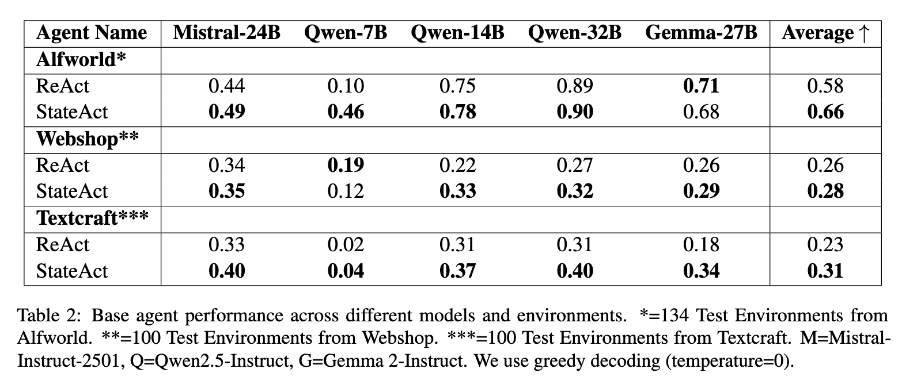

# StateAct Paper

This is the **OFFICIAL** implementation of the stateact paper:
[https://arxiv.org/abs/2410.02810]

---
## Getting started
Look in the "*_runs" sub-folders for **Detailed READMEs** for the invididual environments:

Environments for StateAct:
1. [Alfworld](/alfworld_runs)
2. [Webshop](/webshop_runs)
3. [Textcraft](/textcraft_runs)

For the shared library:

```bash
pip install -e ".[dev]"   # core package + pytest / ruff / pandas / pyyaml

make test     # pytest
make lint     # ruff + shell syntax checks
make build    # wheel + sdist
```

The same checks run in `.github/workflows/ci.yml`.

---

## Repository layout (v2)

The `v2` branch factors the code shared by the three benchmarks into a small,
dependency-free package; the original benchmark scripts remain the entry
points and keep working unchanged.

```
stateact/
  parsing.py      # action extraction + observation normalisation (stdlib only)
  prompts.py      # few-shot prompt assembly and --agent dispatch
  agents.py       # local vLLM + one requests-based URL backend + manual
  llm.py          # --llm_type registry (legacy names kept as aliases)
  envs/           # optional benchmark adapters (ALFWorld reset/step/skip)
  results.py      # unified summary.csv / episodes.csv + RunLogger
  scoring.py      # score one run (stdlib CSV fallback)
  analysis/       # loaders for the unified format + notebook compatibility
  run_config.py   # runs named experiments from experiments/*.yaml
experiments/
  alfworld.yaml   # replaces the ~1000-line if/elif shell registry
  webshop.yaml
alfworld_runs/    # ALFWorld entry point + paper prompt artefacts
webshop_runs/     # WebShop entry point + vendored environment client
textcraft_runs/   # TextCraft entry points
scripts/          # PBS jobs for A100 (ALFWorld + WebShop)
tests/            # unit tests for stateact (no benchmark install needed)
```

There are no provider SDKs in the core: models are either **local** (vLLM) or
**URL-based** (any OpenAI-compatible endpoint through `requests`). The old
`--llm_type` names (`OpenAIChatText`, `NvidiaChatText`, ...) are kept as
aliases for the same URL backend, so existing commands keep working.

For analysis:

All three benchmarks now write the same two files:

```text
<results_folder>/<trial>/
  summary.csv    # one row per agent/run
  episodes.csv   # one row per environment episode
```

Benchmark-specific values are kept in a `details` JSON column. The analysis
loaders also understand the old `alfworld_results.csv`, WebShop `scores.csv`
and TextCraft `results.csv` layouts.

```bash
python -m stateact.analysis alfworld --trial-name baseline_14B --base-folder alfworld_runs/results
python -m stateact.analysis webshop  webshop_runs/results/v6_api_paper --best
python -m stateact.analysis textcraft textcraft_runs/results/v9_d3_full
```

Named experiments can be listed or dry-run without installing ALFWorld,
WebShop or TextCraft:

```bash
python stateact/run_config.py alfworld --list
python stateact/run_config.py alfworld eval_mix --dry-run
bash alfworld_runs/run_alfworld_eval.sh eval_mix   # old interface, still works
```

CI (`.github/workflows/ci.yml`) runs the test suite on Python 3.9-3.12,
lints the shared package, byte-compiles the benchmark entry points, and builds
the wheel. See [`docs/v2-review.md`](docs/v2-review.md) for the v2 review and
dependency decisions.

## Running on the cluster (PBS)

A100 jobs for a small local model are in `scripts/pbs/`:

```bash
bash scripts/submit_pbs.sh alfworld   # Qwen2.5-7B-Instruct, 134 envs
bash scripts/submit_pbs.sh webshop    # Qwen2.5-3B-Instruct, 100 envs
```

See [`scripts/README.md`](scripts/README.md) for overrides (`MODEL`,
`NUM_ENVS`, `AGENT`, ...) and the SLURM equivalent.


---
## Results:


## Reference:
A machine-readable citation is in [`CITATION.cff`](CITATION.cff). Please cite StateAct:
```bibtex
@article{rozanov2024stateactstatetrackingreasoning,
      title={StateAct: State Tracking and Reasoning for Acting and Planning with Large Language Models}, 
      author={Nikolai Rozanov and Marek Rei},
      year={2024},
      eprint={2410.02810},
      archivePrefix={arXiv},
      primaryClass={cs.AI},
      url={https://arxiv.org/abs/2410.02810}, 
}
```

## Known Follow-on Work / Usage:
- https://github.com/Humaid-Ibrahim/msc-ai-individual-project-agentic-ai-learning

---
(C) - Nikolai Rozanov 2024-Present
